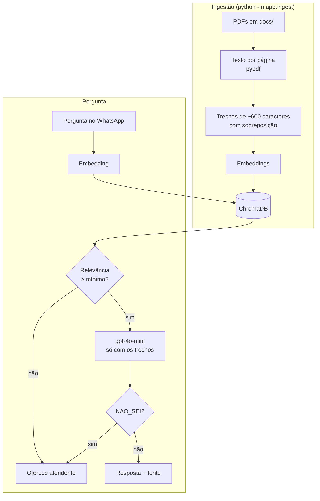

# DocBot 📄🤖

Assistente de WhatsApp que responde clientes com base nos documentos da própria empresa: políticas de troca, prazos de entrega, formas de pagamento, garantia. Cada resposta cita o arquivo e a página de onde saiu. Quando a informação não está nos documentos, o bot passa para um atendente em vez de inventar.


## O que ele faz

- **Lê PDFs** da pasta `docs/`, divide em trechos com frases inteiras e guarda num banco vetorial (ChromaDB).
- **Busca por significado**: a pergunta "posso devolver se não gostei?" encontra o trecho sobre arrependimento, mesmo sem as mesmas palavras.
- **Resposta presa aos documentos**: a IA recebe só os trechos encontrados e é instruída a responder `NAO_SEI` se a resposta não estiver neles.
- **Cita a fonte**: `📄 politica-trocas.pdf p.2`.
- **Limite de relevância**: se nenhum trecho for parecido o bastante com a pergunta, o bot nem chama a IA e oferece atendente.
- **Transbordo humano** com aviso para o atendente e volta automática ao bot.
- **Perguntas sem resposta** ficam registradas e mostram o que falta acrescentar nos documentos.
- **Modo offline**: sem chave da OpenAI, funciona por palavras-chave e responde com frases extraídas dos PDFs. Dá para testar tudo de graça.

## Exemplo

```
você › Qual o prazo para trocar um produto?
bot  › Você pode solicitar a troca de um produto em até 30 dias após o recebimento.
       Produtos com defeito de fabricação podem ser trocados em até 90 dias após o recebimento.
       Fonte: 📄 politica-trocas.pdf p.1 · 📄 politica-trocas.pdf p.2

você › Vocês vendem carro usado?
bot  › Não encontrei essa informação nos documentos da loja e prefiro não chutar. 🙏
       Quer falar com um atendente?   [Falar com atendente]  [Outra pergunta]
```

## Como funciona



Cada peça tem duas versões com os mesmos métodos, escolhidas pelo `.env`:

| Peça | Com `OPENAI_API_KEY` | Modo offline |
|---|---|---|
| Embeddings | `text-embedding-3-small` | palavras-chave com radical |
| Banco vetorial | ChromaDB em disco | NumPy em memória |
| Resposta | `gpt-4o-mini` | frases extraídas dos trechos |

## Rodando no seu computador

Use Python 3.11 ou 3.12 (o ChromaDB ainda não tem suporte completo ao 3.13).

```bash
git clone https://github.com/mauricio729/docbot.git
cd docbot
python -m venv .venv
source .venv/bin/activate        # Windows: .venv\Scripts\activate
pip install -r requirements.txt
cp .env.example .env
```

**Conversar pelo terminal** (modo offline, com os PDFs de exemplo):

```bash
python -m app.chat
```

**Com a OpenAI:** coloque sua chave em `OPENAI_API_KEY` no `.env`, indexe os documentos uma vez e converse:

```bash
python -m app.ingest
python -m app.chat
```

**Testes:**

```bash
pytest
```

**API:**

```bash
uvicorn app.main:app --reload     # http://localhost:8000/docs
```

Teste uma pergunta e veja os detalhes da busca:

```bash
curl -X POST localhost:8000/perguntar -H "X-Api-Key: troque-esta-chave" \
  -H "Content-Type: application/json" -d '{"pergunta": "o frete é grátis?"}'
```

```json
{
  "resposta": "O frete é grátis para compras acima de R$ 199,00 em todo o Brasil.",
  "encaminhar_para_atendente": false,
  "confianca": 0.72,
  "fontes": [{"arquivo": "entrega-e-frete.pdf", "pagina": 1}]
}
```

## Usando os documentos da sua empresa

1. Apague os PDFs de exemplo de `docs/` e coloque os seus.
2. Rode `python -m app.ingest` (ou `POST /reindexar` com a API no ar).
3. Acompanhe `GET /perguntas-sem-resposta` para descobrir o que os clientes perguntam e ainda não está escrito.

Os PDFs de exemplo foram gerados por `scripts/gerar_pdfs_exemplo.py` e são de uma loja fictícia.

O WhatsApp é configurado do mesmo jeito que no [ZapAtende](https://github.com/mauricio729/zapatende#conectando-ao-whatsapp-de-verdade).

## Rotas

Todas, exceto o webhook e `/health`, pedem o cabeçalho `X-Api-Key`.

| Método | Rota | O que faz |
|---|---|---|
| GET/POST | `/webhook` | Verificação e mensagens do WhatsApp |
| POST | `/perguntar` | Resposta completa com confiança e fontes |
| GET | `/perguntas-sem-resposta` | Perguntas que o bot não soube responder, mais frequentes primeiro |
| POST | `/reindexar` | Relê os PDFs da pasta `docs/` |
| POST | `/atendimentos/{telefone}/encerrar` | Devolve o cliente ao bot |
| GET | `/health` | Modo em uso e número de trechos indexados |

## Estrutura

```
app/
├── bot.py            # conversa no WhatsApp e transbordo
├── chat.py           # conversa pelo terminal
├── container.py      # escolhe OpenAI ou modo offline
├── documents.py      # leitura dos PDFs e divisão em trechos
├── embeddings.py     # OpenAI ou palavras-chave
├── ingest.py         # indexação dos PDFs
├── llm.py            # prompt e geração da resposta
├── main.py           # API FastAPI
├── question_log.py   # perguntas sem resposta
├── rag.py            # busca + limite de relevância + citação
├── vectorstore.py    # ChromaDB ou memória
└── whatsapp.py       # Cloud API
docs/                 # PDFs de exemplo
scripts/gerar_pdfs_exemplo.py
tests/
```

---

Feito por [Mauricio Rodrigues](https://github.com/mauricio729) · Uberlândia, MG
